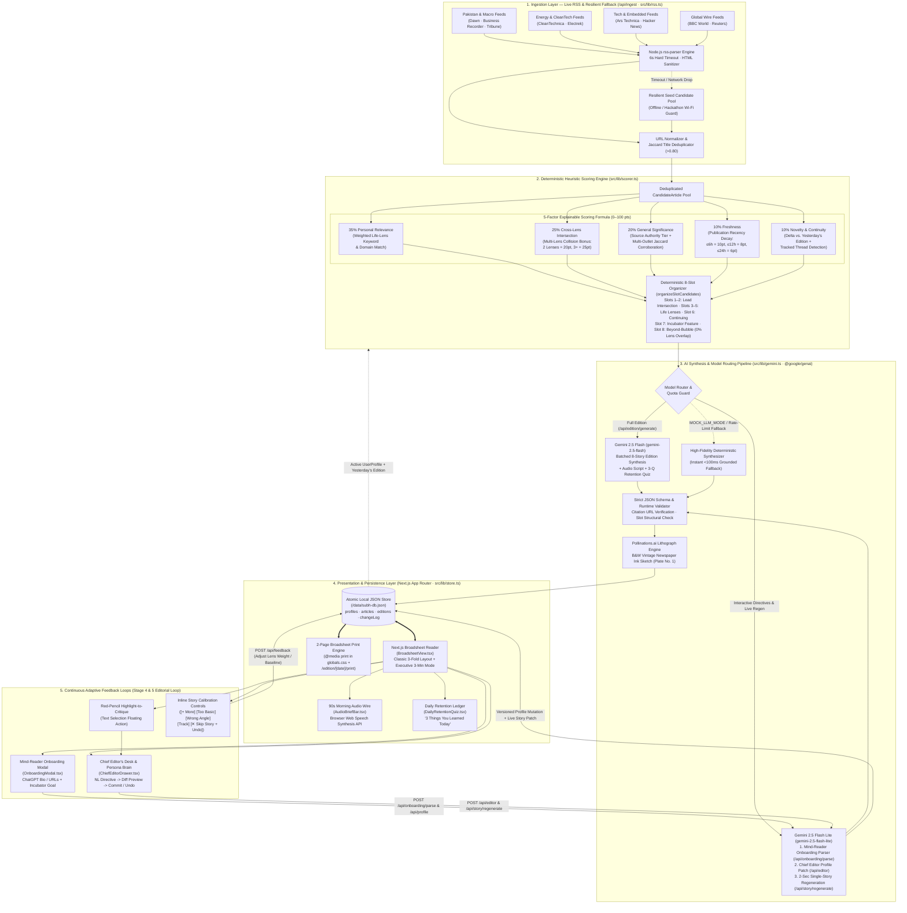

# SUBH BAKHABAR (صبح باخبر) — System Architecture & Technical Reference

> **Event:** NaSCon'26 AI Hackathon  
> **Tagline:** *An agentic, finite morning newspaper that understands who you are, how world events intersect with your life, what changed since yesterday, and who you want to become.*

---

## 1. System Overview & Design Philosophy

**SUBH BAKHABAR (صبح باخبر)** — *"Your World, In Perspective"* — reimagines personal intelligence as an intentional, finite morning ritual rather than an infinite algorithmic feed. Modern news aggregators optimize for outrage, click-through velocity, and filter-bubble reinforcement. By contrast, **SUBH BAKHABAR** acts as an autonomous **Editorial Board & Personal Chief Editor** governed by five architectural principles:

1. **The Finite 8-Story Protocol (Zero Infinite Scroll):** Every daily edition is an immutable snapshot containing **strictly 8 curated slots** across three newspaper folds:
   - **Slots 1 & 2 (`lead_intersection`):** Cross-disciplinary lead dispatches where two or more of the reader's Life Lenses collide with global or domestic policy.
   - **Slots 3, 4 & 5 (`life_lens`):** Dedicated vertical dispatches calibrated to the exact technical baseline (`beginner` | `intermediate` | `expert`) and preferred editorial angle of each Life Lens.
   - **Slot 6 (`continuing`):** *"What Changed Since Yesterday?"* — longitudinal tracking of evolving story threads (`threadId`) with structured `Previously` / `Today` / `Remains Uncertain` ledgers.
   - **Slot 7 (`incubator`):** *"Who You Want to Become"* — an Economist-style Special Briefing & Daily Mastery Dossier tailored to the reader's active learning goal (e.g., **CSS Exam 4-Part Analytical Breakdown**, **German via Tech News Bilingual Passage**, or **Formula 1 Domain Primer**).
   - **Slot 8 (`beyond_bubble`):** High-significance global reporting with **0% overlap** with the reader's primary filters to guarantee intellectual serendipity and prevent echo chambers.
2. **Strict Primary-Source Grounding (Zero Hallucinated URLs):** The AI synthesis pipeline never invents news or citations. Every `StoryItem` is synthesized from real candidate articles ingested via live RSS feeds (`Dawn`, `Reuters`, `CleanTechnica`, `Ars Technica`, `BBC World`, `Business Recorder`, `The Express Tribune`, `Electrek`, `Hacker News`), preserving exact source URLs, timestamps, and cross-outlet framing comparisons (`framingDivergence`).
3. **Explainable Deterministic Ranking (35 / 25 / 20 / 10 / 10 Heuristic):** Before any LLM token is spent, candidate articles are scored deterministically from `0–100` across five transparent dimensions so every story carries an auditable `intersectionScore` and `includedBecause` badge.
4. **Single Source of Truth Across Modalities:** The Classic Web Broadsheet, the Executive 3-Minute Dispatch view, the 90-second Web Speech Audio Wire, the Interactive Retention Quiz, and the 2-Page `@media print` Broadsheet PDF all consume the exact same schema-validated `Edition` JSON snapshot persisted in `/data/subh-db.json`.
5. **Continuous Bidirectional Feedback & Auditable Persona Brain:** Readers are not passive consumers. Through inline story calibration (`+ More`, `Too Basic`, `Wrong Angle`, `Track`, `Skip Story`), **Red-Pencil Highlight-to-Critique** text selection, and the **Chief Editor's Desk** natural-language command bar, every critique mutates the underlying `UserProfile` with a versioned, reversible `ProfileChangeLog` and supports **2-second live single-story regeneration**.

---

## 2. End-to-End Architecture Flowchart (Mermaid.js)

---

## 3. Data Flow & Schema Validation (NaSCon Submission Specification)

### 3.1 Five-Stage Request & Synthesis Lifecycle

1. **Stage A — Concurrent RSS Ingestion & Sanitization (`/api/ingest` -> [`src/lib/rss.ts`](file:///c:/Users/DELL/Desktop/subh-bakhabar/src/lib/rss.ts)):**
   - Concurrent `Promise.allSettled` requests pull XML feeds across 8 curated domestic and international sources with a strict `6000ms` per-feed timeout.
   - `cleanSnippet()` strips embedded `<script>`, `<style>`, and HTML tags while decoding entities into clean 340-character journalistic summaries.
   - `normalizeUrl()` strips tracking parameters (`utm_*`, `fbclid`, `gclid`), and `deduplicateArticles()` eliminates cross-syndicated duplicates whenever token Jaccard similarity exceeds `0.80`.
   - If venue Wi-Fi drops completely, `getFallbackCandidates()` seamlessly synthesizes candidates from cached/seeded editions so the pipeline never crashes.

2. **Stage B — Deterministic 35/25/20/10/10 Ranking ([`src/lib/scorer.ts`](file:///c:/Users/DELL/Desktop/subh-bakhabar/src/lib/scorer.ts)):**
   - Every `CandidateArticle` is evaluated against the active `UserProfile` (`version` $V_n$) and yesterday's `Edition`:
     $$\text{Score} = \underbrace{R_{\text{lens}}}_{\text{35 pts}} + \underbrace{I_{\text{cross}}}_{\text{25 pts}} + \underbrace{S_{\text{authority}}}_{\text{20 pts}} + \underbrace{F_{\text{recency}}}_{\text{10 pts}} + \underbrace{N_{\text{continuity}}}_{\text{10 pts}}$$
   - **Personal Relevance ($0\text{–}35$):** Whole-word and phrase matching against each `LifeLens.keywords` array, scaled by normalized lens `weight` ($0\text{–}100$) and feed category alignment.
   - **Cross-Lens Intersection ($0\text{–}25$):** Awards $20\text{ pts}$ when an article bridges 2 distinct Life Lenses and $25\text{ pts}$ when it bridges $\ge 3$ lenses, surfacing non-obvious systemic connections for the Front-Page Lead slots.
   - **General Significance ($0\text{–}20$):** Combines publisher authority tier (`MAJOR_OUTLET_AUTHORITY`) with a $+6\text{ pt}$ multi-outlet corroboration bonus when independent feeds share $>0.30$ Jaccard token overlap.
   - **Freshness ($0\text{–}10$):** Stepwise decay function rewarding breaking dispatches ($\le 6\text{h} = 10\text{ pts}$, $\le 12\text{h} = 8\text{ pts}$, $\le 24\text{h} = 6\text{ pts}$).
   - **Novelty & Continuity ($0\text{–}10$):** Penalizes repetitive angles from yesterday ($>0.60$ overlap $\rightarrow 2\text{ pts}$) while flagging pinned `trackedStoryIds` ($>0.28$ overlap) as `isContinuityCandidate = true` for Slot 6.
   - **Beyond-Bubble Selection (`selectBeyondBubbleCandidate`):** Filters specifically for articles with `matchedLensIds.length === 0` ranked by `significance + freshness`, ensuring genuine intellectual discovery in Slot 8.

3. **Stage C — Schema-Enforced Gemini Synthesis ([`src/lib/gemini.ts`](file:///c:/Users/DELL/Desktop/subh-bakhabar/src/lib/gemini.ts)):**
   - **Model Tiering:**
     - `gemini-2.5-flash` powers `/api/edition/generate`, transforming the 8 organized slot candidates into a complete `Edition` in a single structured JSON call (`responseMimeType: "application/json"`).
     - `gemini-2.5-flash-lite` powers low-latency interactive routes: `/api/onboarding/parse` (extracting Life Lenses from raw bio/URLs), `/api/editor` (computing structured `UserProfile` diffs from natural-language directives), and `/api/story/regenerate` (rewriting a single `StoryItem` in-place in under 2 seconds).
   - **Citation Integrity Guardrail:** During post-processing, every generated `StoryItem.citations` array is validated against the input `CandidateArticle.link`. If an LLM response omits or alters a URL, the validator forcefully restores the authentic candidate source URL and timestamp.

4. **Stage D — Atomic Persistence & Versioned Audit Log ([`src/lib/store.ts`](file:///c:/Users/DELL/Desktop/subh-bakhabar/src/lib/store.ts)):**
   - All state is persisted to `/data/subh-db.json` through an in-process serialized `writeQueue` using atomic temp-file-and-rename writes (`subh-db.json.<pid>.<timestamp>.tmp` $\rightarrow$ `subh-db.json`), preventing race conditions or partial writes.
   - Every profile change via `updateActiveProfile()` increments `UserProfile.version` monotonically and appends a `ProfileChangeLog` entry recording `previousState` and `newState` snapshots for 1-click **Undo**.

5. **Stage E — Multi-Modal Broadsheet & 2-Page Print PDF Rendering:**
   - **Web Reader ([`BroadsheetView.tsx`](file:///c:/Users/DELL/Desktop/subh-bakhabar/src/components/newspaper/BroadsheetView.tsx)):** Renders the 3-fold newspaper layout with instant switching between **Broadsheet Layout** and **Executive 3-Min Dispatch** mode (`buildExecutiveBullets`).
   - **True 2-Page Broadsheet PDF ([`src/app/globals.css`](file:///c:/Users/DELL/Desktop/subh-bakhabar/src/app/globals.css) & `/edition/[date]/print`):** Triggering `window.print()` (or visiting `/edition/[date]/print`) activates `@media print` rules that strip all interactive buttons, drawers, tooltips, audio bars, and quiz chrome (`.no-print`), enforce a crisp 12-column grid (`.print-grid-12`), lock **Page 1** to the Masthead + Fold I (2 Leads, Lithograph Cartoon, 3 Life-Lens Dispatches) and **Page 2** (`.print-sheet-2`) to Fold II (Continuing + Beyond Bubble) + Fold III (4-Part Incubator Dossier) + Colophon with `break-inside: avoid` on every story card.

---

### 3.2 Core TypeScript Contracts ([`src/types/subh.ts`](file:///c:/Users/DELL/Desktop/subh-bakhabar/src/types/subh.ts))

| Schema Entity | Key Validated Fields & Invariants | Role in Architecture |
| :--- | :--- | :--- |
| **`UserProfile`** | `id`, `version` (monotonic int), `lifeLenses: LifeLens[]` (3–4 lenses with `weight` 0–100 & `knowledgeBaseline`), `incubatorGoal: IncubatorGoal`, `trackedStoryIds: string[]`, `changeLog: ProfileChangeLog[]` | Living "Persona Brain" driving both the 35/25/20/10/10 heuristic scorer and Gemini synthesis prompts. |
| **`CandidateArticle`** | `id`, `title`, `link` (normalized URL), `sourceName`, `feedCategory`, `publishedAt`, `snippet` (sanitized $\le 340$ chars), `score?`, `matchedLensIds?` | Grounded raw news unit ingested from RSS feeds before LLM synthesis. |
| **`StoryItem`** | `id`, `slotType` (`lead_intersection` \| `life_lens` \| `continuing` \| `incubator` \| `beyond_bubble`), `threadId?`, `headline`, `subheadline`, `reportedFacts`, `citations: Citation[]`, `provenanceBadge`, `whyYou`, `includedBecause`, `intersectionScore` (0–100), `whatToWatchNext`, `continuity?`, `framingDivergence?`, `incubatorModule?` | Single newspaper dispatch combining strictly factual reporting, verified provenance links, and personalized editorial synthesis. |
| **`IncubatorModule`** | Discriminated union on `kind`: • `css_brief` (`background`, `coreIssue`, `policyAngle`, `wayForward`, `practiceQuestion`, `keyTerms`) • `domain_primer` (`concept`, `explanation`, `analogy`, `keyTerms`) • `bilingual_passage` (`language`, `passage`, `translation`, `vocabulary`) | Powers Fold III's Economist-style Special Briefing to advance the reader's daily mastery goal. |
| **`Edition`** | `date` (`YYYY-MM-DD`), `editionNumber`, `profileVersion`, `origin` (`seed` \| `gemini` \| `mock`), `mastheadQuote`, `editorialNote`, `editorialCartoon`, `audioBriefScript` (~150 words), `stories: StoryItem[8]`, `dailyQuiz: QuizQuestion[3]` | Immutable daily broadsheet snapshot shared identically across Web Reader, Print PDF, Archive, Audio Wire, and Retention Quiz. |

